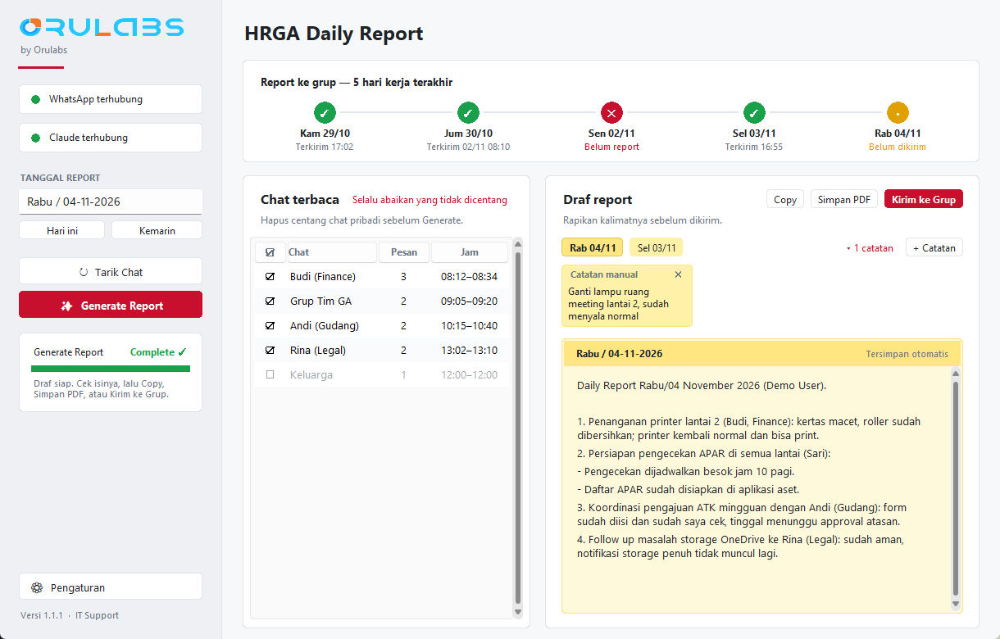
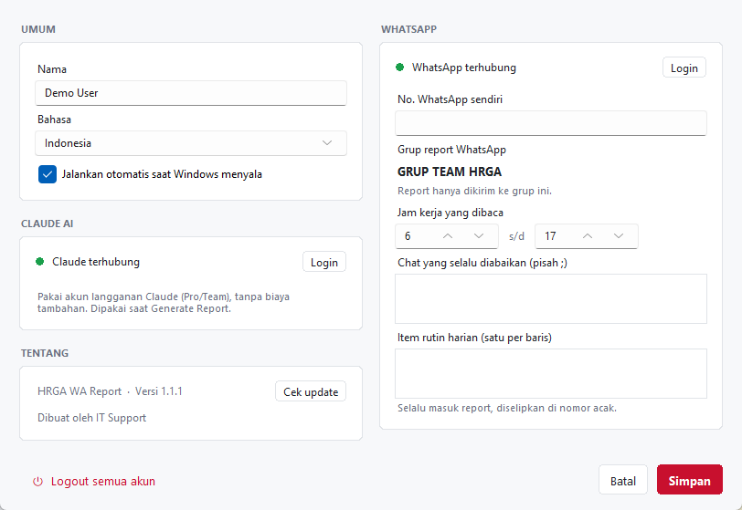

# HRGA WA Report

App Windows untuk tim HRGA: tarik chat WhatsApp hari ini, susun daily report dengan Claude, lalu kirim ke grup tim.



## Fitur

- **Tarik chat WhatsApp:** semua chat yang aktif di tanggal report (bisa hari ini atau hari sebelumnya), dibaca lewat WhatsApp Web tanpa membuka jendela browser.
- **Tabel chat:** tiap chat ditampilkan dengan jumlah pesan dan rentang jam. Chat pribadi bisa dibatalkan centangnya, atau dimasukkan ke daftar "selalu abaikan".
- **Report disusun Claude:** tombol Generate Report mengirim chat kerja yang sudah disaring ke Claude Code di laptop itu. Claude menulis report dengan format daily report: satu poin per pekerjaan, sub-poin per orang, lengkap dengan status, dan item rutin harian di nomor acak.
  - Memakai akun langganan Claude yang login di laptop (Pro/Team), bukan API key, jadi tidak ada biaya tambahan.
  - Semua tool Claude dimatikan; Claude hanya menerima teks chat dan mengembalikan teks report.
  - Hanya chat dari jam kerja (bawaannya 06:00–17:00). Foto, stiker, dan ucapan duka dibuang, dan password, OTP, serta nomor rekening disamarkan sebelum dikirim.
  - Kalau Claude tidak terpasang atau belum login, app menyusun draf tanpa AI: dikelompokkan per jenis pekerjaan dengan status selesai/dalam proses.
- **Draf ala Sticky Notes per tanggal:** draf report tampil di kertas kuning per tanggal yang tersimpan otomatis. Pindah tanggal lewat deretan chip tanggal atau kalender.
- **Catatan manual:** tambahkan sticky note untuk pekerjaan yang tidak ada di chat; catatan ini ikut masuk report saat Generate. Catatan bisa disembunyikan, dan catatan yang terhapus bisa dikembalikan dengan Undo/Redo.
- **Kalender dengan libur nasional:** klik tanggal report untuk membuka kalender dropdown, lengkap dengan daftar libur nasional Indonesia bulan itu.
- **Kirim ke grup:** report dikirim hanya ke grup **GRUP TEAM HRGA**. Selain itu, draf bisa disalin atau disimpan sebagai PDF berkop logo perusahaan.
- **Terjemahkan (DeepL):** satu klik menerjemahkan draf ke Inggris lewat DeepL web (gratis, tanpa API key). Nama hari di judul tetap Indonesia, sapaan pak/mas/mba tidak diubah jadi Mr./Ms., dan Ctrl+Z mengembalikan versi Indonesia.
- **Chat Claude:** tanya jawab dengan Claude langsung di app, mis. "poin 3 dasarnya dari chat mana?" atau "poin 2 bukan kerjaan saya, hapus". Claude melihat draf, item rutin, catatan, dan chat WhatsApp tanggal yang dibuka; revisi report bisa diterapkan ke draf dengan satu klik.
- **Server HRGA, Kirim ke Fena, dan Rekap Tim:** satu PC server menampung report seluruh tim untuk Fena. Tim Android (tanpa laptop) membuka halaman web di HP, mengetik atau mendikte cerita pekerjaan, lalu Claude merapikannya jadi daily report. Tim laptop mengirim report ke Fena dari app. Fena melihat siapa yang sudah/belum report di Rekap Tim. Akses dari luar kantor lewat Tailscale Funnel, login nama + PIN. Panduan: [docs/server.md](docs/server.md).
- **Timeline 5 hari kerja:** menandai hari yang sudah report ke grup dan yang terlewat, dibaca langsung dari isi grup. Report yang dikirim manual juga ikut terhitung.
- **Indikator WhatsApp dan Claude:** menunjukkan apakah sesi WhatsApp Web dan login Claude masih tersambung.
- **Panel progres:** persentase 0–100% untuk setiap proses, lalu "Complete" saat selesai.
- **Bahasa Indonesia / English:** untuk tampilan app dan judul report.
- **Jalan otomatis:** app bisa dibuka otomatis setiap Windows menyala.
- **Update otomatis:** app mengecek rilis baru di GitHub saat dibuka. Bisa juga dicek manual di Pengaturan > Cek update.



## Instalasi

1. Unduh `HRGA-WA-Report-Setup-<versi>.exe` dari halaman [Releases](https://github.com/r0corp/hrga-wa-report/releases/latest), lalu jalankan.
   - Tidak perlu hak admin; app dipasang per user.
   - App memakai Microsoft Edge bawaan Windows, jadi tidak ada browser tambahan yang dipasang.
2. Buka app, klik **Pengaturan**, lalu isi nama.
3. Klik **Hubungkan WhatsApp** dan scan QR code dari HP (WhatsApp > Perangkat tertaut > Tautkan perangkat).
4. Pastikan aplikasi Claude desktop terpasang. Saat pertama kali Generate, app menawarkan login Claude sekali lewat browser.
5. Setiap sore: **Tarik Chat**, lalu **Generate Report**, cek isinya, dan **Kirim ke Grup**.

Data tiap laptop (sesi WhatsApp, chat, report, pengaturan) disimpan di `%LOCALAPPDATA%\HRGA WA Report`. Yang keluar dari laptop hanya teks chat kerja yang sudah disaring dan disamarkan, dikirim ke Claude saat Generate Report.

## Catatan

- Membuka chat membuat pesan tertandai dibaca (centang biru).
- Otomatisasi WhatsApp Web tidak diizinkan oleh ketentuan WhatsApp. App ini hanya membaca dengan jeda, tapi risikonya tidak nol.

## Pengembangan

```
python -m venv venv
venv\Scripts\pip install -r requirements.txt
venv\Scripts\python -m pytest -q
venv\Scripts\python app.py
```

### Build dan rilis

1. Naikkan `VERSION` di `core/updater.py`.
2. Jalankan `powershell -ExecutionPolicy Bypass -File build.ps1`. Hasilnya ada di `dist\`:
   - `HRGA WA Report.exe`
   - `HRGA-WA-Report-Setup-<versi>.exe` (perlu [Inno Setup 6](https://jrsoftware.org/isinfo.php))
3. Buat rilis GitHub dengan tag `v<versi>` dan lampirkan kedua file itu. App yang sudah terpasang memakai `.exe` app (bukan installer) untuk update otomatis.

---

Dibuat oleh IT Support.
